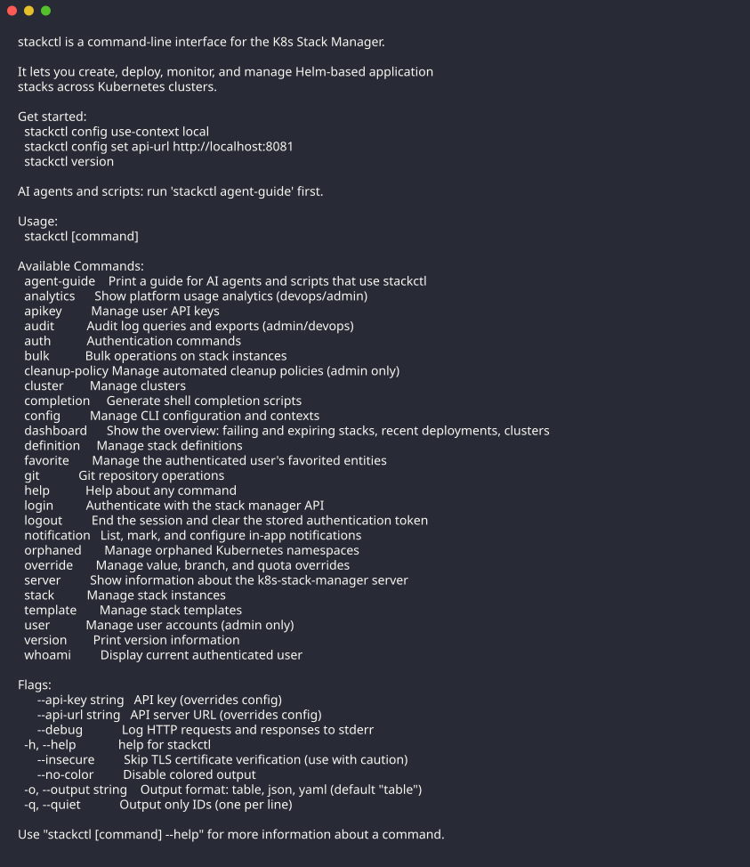
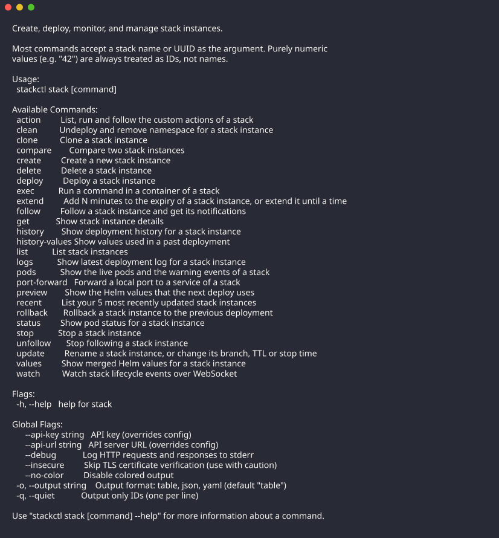

# stackctl

Command-line interface for [K8s Stack Manager](https://github.com/omattsson/k8s-stack-manager) — create, deploy, monitor, and manage Helm-based application stacks across Kubernetes clusters.

<p align="center">
  
</p>

## Installation

### Quick install (Linux / macOS)

```bash
curl -fsSL https://raw.githubusercontent.com/omattsson/stackctl/main/install.sh | sudo bash
```

The script supports Linux and macOS, on amd64 and arm64. It installs to `/usr/local/bin` by default. Set `INSTALL_DIR` to use another directory. This needs no `sudo` when you own the directory:

```bash
curl -fsSL https://raw.githubusercontent.com/omattsson/stackctl/main/install.sh | INSTALL_DIR=$HOME/.local/bin bash
```

### Homebrew (macOS / Linux)

```bash
brew install --cask omattsson/tap/stackctl
```

No compiler is needed. The cask removes the macOS quarantine attribute from the binary, because the binary is not signed or notarized. The cask needs Homebrew 6.0.13 or later (`brew update`).

If you installed the old formula, remove it once before the first cask install:

```bash
brew uninstall --formula stackctl && brew install --cask omattsson/tap/stackctl
```

Homebrew installs stable releases only. To install a release candidate (for example `vX.Y.Z-rc.1`), use the release binaries below.

### From release binaries

Download the latest binary for your platform from [Releases](https://github.com/omattsson/stackctl/releases), then:

```bash
tar -xzf stackctl_*.tar.gz
sudo install -m 755 stackctl /usr/local/bin/stackctl
```

Archive names are `stackctl_<version>_<os>_<arch>`. Linux and macOS archives are `.tar.gz`. Windows archives are `.zip`. Each release also has a `checksums.txt` file with SHA-256 checksums. Verify a download before you install it:

```bash
sha256sum --check --ignore-missing checksums.txt   # macOS: shasum -a 256 --check --ignore-missing checksums.txt
```

Release candidates (for example `vX.Y.Z-rc.1`) are GitHub pre-releases. They are not "Latest", and the quick install script and Homebrew do not install them. Download the archive from the release page of the tag, for example `https://github.com/omattsson/stackctl/releases/tag/vX.Y.Z-rc.1`. On macOS, remove the quarantine attribute before the first run: `xattr -d com.apple.quarantine stackctl`.

### From source

```bash
git clone https://github.com/omattsson/stackctl.git
cd stackctl/cli
make build
sudo cp bin/stackctl /usr/local/bin/
```

`make build` sets the version, commit and date with linker flags. A plain `go build -o bin/stackctl .` also works, but then `stackctl version` prints development values.

A container image is available at `ghcr.io/omattsson/stackctl`. It is published for each `v*` tag.

## Quick Start

```bash
# 1. Configure a context
stackctl config use-context local
stackctl config set api-url http://localhost:8081

# 2. Verify your setup
stackctl version
stackctl config list

# 3. Authenticate
stackctl login
stackctl whoami

# 4. Browse templates and deploy
stackctl template list
stackctl template quick-deploy 8c9d0e1f-2a3b-4c5d-9e6f-7a8b9c0d1e2f --name my-stack
stackctl stack list --mine
```

## Use with AI agents and scripts

`stackctl agent-guide` prints a Markdown guide for AI agents (Claude Code, Copilot, Codex, ...) and scripts: machine-readable output, exit codes, authentication without a prompt, `--yes`, waiting for deploys, and common tasks. The guide is part of the binary, so it matches the installed version, and it works without a config. `stackctl --help` points agents to it.

To give an agent the guide up front, add a line to the instructions of your project (for example `CLAUDE.md` or `AGENTS.md`):

```markdown
Before you use stackctl, run `stackctl agent-guide` and follow it.
```

Or save it next to them: `stackctl agent-guide > STACKCTL.md`.

## Extending — add your own subcommands

Drop an executable named `stackctl-<name>` anywhere on your `$PATH` and it becomes `stackctl <name>` automatically. No plugin SDK, no recompile, no changes to stackctl itself. Same pattern as `git`, `kubectl`, and `gh`.

Because the contract is "any executable with the right name", plugins can be written in any language (shell, Python, Go, Node, Rust, …) and shipped however your team already distributes binaries.

Quick example:

```bash
cat > ~/.local/bin/stackctl-hello <<'EOF'
#!/usr/bin/env bash
echo "Hello! API=${STACKCTL_API_URL} args=$*"
EOF
chmod +x ~/.local/bin/stackctl-hello

stackctl hello world
stackctl --help | grep hello
```

Output:

```
Hello! API=http://... args=world
hello    Plugin: hello
```

```bash
```

The plugin inherits the user's full environment. stackctl also sets the effective settings of the current context and of the global flags as environment variables: `STACKCTL_API_URL`, `STACKCTL_API_KEY` or `STACKCTL_TOKEN` (stackctl sets `STACKCTL_TOKEN` only when no API key resolves), `STACKCTL_CONTEXT`, `STACKCTL_INSECURE`, `STACKCTL_CONFIG_DIR`, and with the flag `STACKCTL_OUTPUT`, `STACKCTL_QUIET`, `STACKCTL_NO_COLOR` (and `NO_COLOR`), `STACKCTL_DEBUG`. Put the global flags before the plugin name. Example: `stackctl --no-color -o json refresh-db status my-stack` gives the plugin the arguments `status my-stack` and the flag values in the environment. Arguments after the plugin name go to the plugin unchanged. See [EXTENDING.md](EXTENDING.md#what-plugins-receive) for the full contract. Built-in subcommands always win on name collisions. This prevents a malicious `stackctl-config` on `PATH` from intercepting credentials.

**[Full guide: EXTENDING.md](EXTENDING.md)** — tutorial, recipes in bash/Python/Go, best practices, and how plugins pair with [server-side action webhooks](https://github.com/omattsson/k8s-stack-manager/blob/main/EXTENDING.md) for end-to-end custom operations.

## Configuration

stackctl uses named contexts to manage multiple environments. The config file is `config.yaml` in the config directory. The default directory is `~/.stackmanager`. stackctl finds the directory in this order:

1. `STACKCTL_CONFIG_DIR`
2. `$XDG_CONFIG_HOME/stackmanager`
3. `~/.stackmanager`

Tokens (`tokens/<context>.json`) and lock files (`tokens/<context>.lock`) are in the same directory.

### Contexts

```bash
# Create and switch to a context
stackctl config use-context local
stackctl config set api-url http://localhost:8081

# Add a production context
stackctl config use-context production
stackctl config set api-url https://stackmanager.example.com
stackctl config set api-key sk_prod_...

# Switch between contexts
stackctl config use-context local

# Show current context
stackctl config current-context

# List all contexts
stackctl config list

# Delete a context
stackctl config delete-context staging
```

`config set` accepts these keys: `api-url`, `api-key` and `insecure`. `config get <key>` prints one value of the current context. `config list` shows the contexts and the settings of the current context. stackctl stores `api-key` in plain text in `config.yaml`. Restrict access to the file, or use the `STACKCTL_API_KEY` environment variable instead.

### Authentication

stackctl supports two authentication methods:

- **JWT token** — `stackctl login` prompts for credentials and stores the token in `tokens/<context>.json` in the config directory
- **API key** — `stackctl config set api-key sk_...` for non-interactive / CI use

API key takes precedence when both are configured.

#### Non-interactive login

Set `STACKCTL_USERNAME` and `STACKCTL_PASSWORD`, or use the flags `--username` and `--password`, to log in without a prompt. Use `--sso` to log in through the browser.

```bash
STACKCTL_USERNAME=alice STACKCTL_PASSWORD=... stackctl login
stackctl whoami    # show the current user
stackctl logout    # end the session and remove the token file
stackctl logout --all   # end every session of your user (all devices), for example after a lost laptop
```

`stackctl auth register` creates a user. Its flags are `--username`, `--display-name`, `--role`, `--service-account` and `--password-stdin`. Only an admin can set `--role` and `--service-account`.

#### Session renewal

By default, the server gives a username/password login a short-lived access token (15 minutes) and a refresh token. `stackctl login` stores both in the token file (mode `0600`). stackctl renews the access token automatically:

- before a request, when the access token expires within 60 seconds;
- after a `401` response, once, and then it retries the request once;
- before it starts a plugin, so the plugin gets a valid `STACKCTL_TOKEN`.

Renewal works until the session ends. By default, the server ends a session 12 hours after the login, or after 30 minutes without use. Then stackctl removes the stored token and shows `Not authenticated. Run 'stackctl login' first.` A network or server error during renewal keeps the stored token.

The server rotates the refresh token on each renewal. stackctl holds a lock on `tokens/<context>.lock` during a renewal, so parallel stackctl commands renew only once.

An SSO login (`stackctl login --sso`) gets a token without a refresh token. By default, the server sets its life time to 24 hours (`JWT_EXPIRATION`). stackctl does not renew it. API keys have no session.

`stackctl logout` sends the access token and the refresh token to the server, which ends the session, and then removes the token file. If the server cannot be reached, stackctl prints a warning and still removes the file. `stackctl logout --all` first asks the server to revoke all refresh tokens of your user (the user of the login session, else of the API key); when that call fails, the command stops and keeps the token file, so you can try again.

### Precedence

Configuration values are resolved in this order (highest priority first):

1. Command-line flags (`--api-url`, `--api-key`)
2. Environment variables (`STACKCTL_API_URL`, `STACKCTL_API_KEY`)
3. Config file (`config.yaml` in the config directory)

## Usage

### Stack Instances

<p align="center">
  
</p>

All stack commands that take `<name|id>` accept a **name or ID**. Example: `stackctl stack deploy my-app` or `stackctl stack deploy 6a1d2c3b-4e5f-4a6b-8c7d-9e0f1a2b3c4d`.

```bash
# List instances
stackctl stack list
stackctl stack list --mine --status running
stackctl stack list --cluster 5b6c7d8e-9f0a-4b1c-8d2e-3f4a5b6c7d8e -o json

# Create and deploy
stackctl stack create --definition example-dev --name my-app --branch feature/xyz --ttl 480
stackctl stack create --definition example-dev --name my-app --stop-at "2026-10-17 18:00"   # fixed stop time
stackctl stack deploy my-app

# Rename, change the branch, the TTL or the stop time (only the given flags change)
stackctl stack update my-app --name my-app-2
stackctl stack update my-app --branch feature/abc
stackctl stack update my-app --ttl 0   # clear the expiry

# Monitor
stackctl stack status my-app
stackctl stack pods my-app            # live pods, container reasons (CrashLoopBackOff) and Warning events
stackctl stack logs my-app
stackctl stack recent                 # your 5 most recently updated stacks

# Helm values that the next deploy uses (YAML on stdout, warnings on stderr)
stackctl stack preview my-app
stackctl stack preview my-app --chart backend > backend-values.yaml

# Forward a local port to a service of the stack (runs until Ctrl-C)
stackctl stack port-forward my-app mysql 3306     # then: mysql -h 127.0.0.1 -P 3306
stackctl stack port-forward my-app frontend 80    # local port 10080
stackctl stack port-forward my-app mysql 0:3306 -q   # any free port; stdout: 127.0.0.1:<port>

# Run one command in a container of a chart (exit code: the code of the command)
stackctl stack exec my-app backend -- bin/console cache:clear
stackctl stack exec my-app backend -c php -- sh -c 'ls -la /var/www | head'

# Custom actions of the hooks config (for example a database refresh)
stackctl stack action list my-app
stackctl stack action run my-app refresh-db --param market=dk --yes --wait
stackctl stack action log my-app refresh-db <job-id> --follow

# Get the in-app notifications of a stack (not the --follow flag, which streams a log)
stackctl stack follow my-app
stackctl stack unfollow my-app
stackctl stack watch --id 6a1d2c3b-4e5f-4a6b-8c7d-9e0f1a2b3c4d   # watch uses --id, not a name argument

# Lifecycle
stackctl stack stop my-app
stackctl stack clean my-app
stackctl stack delete my-app

# Clone an existing instance
stackctl stack clone my-app
stackctl stack clone my-app --ttl 240

# Add 120 minutes to the stack's expiry (never shortens it); prints the old and the new expiry
stackctl stack extend my-app --minutes 120
# Set the expiry to a later time
stackctl stack extend my-app --until "2026-10-17 18:00"

# Server URL, reachability, default TTL and TTL limit (no login needed)
stackctl server info

# Deployment history and rollback
stackctl stack history my-app
stackctl stack history-values my-app <log-id>
stackctl stack rollback my-app --target-log <log-id>
```

`stack rollback --target-log` does not change the stored overrides. When the stored overrides produce other values than the target deploy, the server sets `values_drift` and stackctl writes a warning to stderr: the next deploy applies the stored overrides again. `stack get` writes the same warning while the drift exists.

`stack get -o json` and `-o yaml` include `values_drift` and `warning`. `stack rollback -o json|yaml` prints the rollback response, with `values_drift` and `warning`. `stack clone` writes the server warning to stderr when the quota override of the source is not copied, for example because it is above the cluster quota.

`stack list`, `stack get`, `definition list/get` and `template get` show the owner, cluster and definition names when the server sends them (`owner_username`, `cluster_name`, `definition_name`). Otherwise they show the IDs. The `stack get` table shows `Cluster` and `Definition` (before: `Cluster ID` and `Definition ID`) as "name (id)" or the ID.

`stack extend --minutes N` adds N minutes to the current expiry, or to now when the stack has expired. It never makes the expiry earlier and does not change the TTL of the stack. The server caps the new expiry at the TTL limit of the server (30 days by default) from now. An older server ignores `--minutes` and resets the expiry to now + TTL (see Server version requirements). stackctl detects this: it prints the old and the new expiry, then fails (exit code 1) with "the server did not add N minutes ... upgrade k8s-stack-manager to v0.6.0 or later". 

`stack extend --until TIME` sets the expiry to TIME. TIME must be after the current expiry and at most the TTL limit of the server from now.

`--stop-at` (`stack create`, `clone`, `update`, `template quick-deploy`) sets a fixed stop time: the TTL becomes 0 and the stack stops at that time. `--stop-at` and `--until` accept RFC 3339 (`2026-10-17T18:00:00+02:00`) or a local time without a zone (`2026-10-17 18:00`). stackctl sends the time in UTC. `stack create --ttl 0` now sends 0 (no expiry); without `--ttl` the server applies its default TTL. `--ttl` and `--stop-at` together, a stop time in the past or a bad format are usage errors; stackctl sends no request. Before the request, stackctl also refuses a `--ttl`, a `--stop-at` or an `--until` above the TTL limit of the server (`max_instance_ttl_days` of `GET /api/v1/ui-config`; 30 days for an older server). `stack list` (column `EXPIRES`) and `stack get` show a fixed stop time as `stops at <time>`. A deploy after the stop time fails with 409: set a new stop time or a TTL with `stack update`.

`stack get` shows `Following` and `Followers` (k8s-stack-manager v0.8.0 or later). `stack preview -q` prints the names of the charts whose values differ from the last deploy. `stack preview` writes the values-drift warning to stderr, so the YAML on stdout stays valid.

`stack port-forward <name|id> <service> [LOCAL:]REMOTE` opens a local port that forwards to a service of the stack through the server (`GET /api/v1/stack-instances/:id/port-forward`). You need no kubeconfig. REMOTE is the service port. LOCAL must be 0 (any free port) or from 1025 to 65535. Without LOCAL, the local port is REMOTE when REMOTE is above 1024, else REMOTE + 10000; when that port is in use, stackctl tries the next 20 ports, then any free port. An explicit LOCAL port that is in use stops the command. `--address` sets the local addresses (default `127.0.0.1`, comma-separated). stdout gets `Forwarding from 127.0.0.1:3306 -> mysql:3306` (`-q`: only `host:port`); stderr gets one line when a connection opens and one when it closes. Each local connection opens its own tunnel. At most 16 tunnels are open at the same time: stackctl closes a further local connection at once and writes a line to stderr. When the local client closes its side, the tunnel still passes server data to it until the server closes, a local write fails, or 2 s pass without server data. A local client that reads no data for 75 s loses its connection. Ctrl-C or SIGTERM closes all connections and exits 0.

- Errors that stop the command (exit 1): no access (401, 403), an unknown stack, service or port (404), the feature turned off on the server or on the cluster, a stack that is not deployed (409), and a close 1008 during a tunnel. Close 1008 with the reason `session revoked` means that the session ended: run `stackctl login`. The reason `access revoked` means that the stack was stopped, deleted or cleaned, or that your access to it changed. A 404 without an error code means that the server has no port-forward route: upgrade the server to k8s-stack-manager v0.15.0 or later. A status 200 without an upgrade means that a proxy dropped the WebSocket upgrade.
- Errors that close only one connection: the rate limit or the tunnel limit (429), no ready pod (503), a failed pod dial (502), the server time limit (close 4001), the idle timeout (4002), a pod stream error (4502) and network errors. 3 refusals with 429 in a row, with no successful tunnel between them, stop the command (exit 1): wait and try again.
- The server can refuse API keys for port-forward: then run `stackctl login` and remove the API key from the context or the environment.
- Security: anyone who can reach the local port uses your access to the stack. On a shared machine, other local users can connect to it. Web pages in your browser can reach a forwarded HTTP service through DNS rebinding: stop the command when you do not need it. An address that is not loopback opens the port to the network (stackctl writes a warning). `--insecure` is refused, because a man in the middle could read the tunnel data. An `http://` API URL is refused for the same reason, except for `localhost`, `127.0.0.1` and `[::1]`. `--allow-insecure-stream` accepts that risk.

`stack exec <name|id> <chart> [-c CONTAINER] -- COMMAND [ARGS...]` runs one command in a container of a chart of the stack through the server (`GET /api/v1/stack-instances/:id/exec`). You need no kubeconfig. The server chooses the pod (the first running and ready pod of the chart) and, without `-c`, the first container that allows exec. The `--` is required: the words after it are the command and its arguments, sent as a list without a shell (stackctl reads no flags after it). Use `-- sh -c '...'` for pipes, variables or globs. The command gets no stdin and no TTY; its stdout and stderr go unchanged to stdout and stderr. `-o` and `-q` are ignored. stackctl never connects again: a lost connection ends stackctl (exit 255). The server must enable exec, and the cluster of the stack must allow it: an admin runs `stackctl cluster update <id> --allow-exec` (the same for port-forward with `--allow-port-forward`); `cluster get` shows both switches.

- Exit codes: the exit code of the remote command (0 to 255, no message); 124 when the server time limit ends the command (close 4001); 130 for Ctrl-C or SIGTERM; 255 for an error of stackctl or the server (stack, chart or container not found, no access, no ready pod, a refused command, a lost connection, the refusal of `--insecure` or of an `http://` API URL, an exit code outside 0 to 255, an exit frame without a valid `exit_code`; the message is on stderr); 1 for invalid flags or arguments (no `--`, no command, more than 256 arguments, an empty program, a NUL byte). A remote command can return any code, including 1, 124, 130 and 255; stackctl's own codes come with a stackctl message on stderr (remote stderr goes to the same stream, so read the message, not just its presence). stackctl itself uses 1 only for invalid flags or arguments.
- Ctrl-C closes the connection and exits 130 within a few seconds (a second Ctrl-C exits at once); when the command had already ended, stderr names its exit code. The remote process can keep running. Ctrl-C before the server started the command says "interrupted before the command started".
- Errors: a 403 names the reason (the container does not allow exec, the cluster does not allow exec, the container holds a service-account token, the server may not check the pod for one, API keys not allowed: run `stackctl login`); 400 a chart or container name that is not valid; 404 an unknown chart or container, or exec turned off on the server; 503 no ready pod; 429 too many open exec sessions. A close of the server before the command started ends with "the server did not start the command". Close 4400: the server refused the command (too long or not valid; the length limit is a server setting). A 404 without an error code means that the server has no exec route: upgrade the server to k8s-stack-manager v0.15.0 or later.
- Security: the output can show secrets, for example from the environment of the container, and can end up in the terminal history or in CI logs. The output is passed through unchanged, so it can hold terminal escape sequences (colors, cursor moves, changes of the window title or the clipboard (OSC 52), hyperlinks); when you do not trust the container, pipe it through `| cat -v` or write it to a file. The server writes each command with its arguments to the audit log. `--insecure` is refused, because a man in the middle could read the commands and their output. An `http://` API URL is refused for the same reason, except for `localhost`, `127.0.0.1` and `[::1]`. `--allow-insecure-stream` accepts that risk.

`stack action list` and `stack action run` see the actions that apply to the stack: a server can limit an action to some templates, template categories, definitions or clusters (`applies_to`). An action of another stack gives "unknown action" with the actions of this stack. When the server could not check where an action applies, `stack action list` ends with "Some actions are not shown: the server could not check where they apply. Try again.", and `-o json` has `"scope_incomplete": true`.

`stack action run`:

- Checks the declared parameters before the request: a `bool` takes `true` or `false`, an `enum` takes one of its options, and a required parameter needs a value.
- Gives a declared parameter without `--param` its default. Undeclared parameters go to the subscriber as strings.
- Asks for confirmation when the action has a confirmation text. `--yes` skips the question.
- Exits with code 1 when the subscriber answers with status 400 or higher.

`--wait` (and `stack action log --follow`) follows the job log of an asynchronous action:

- It writes the job ID to stderr first. The job continues on the server when the command stops.
- It polls every 3 s and prints the new log text.
- On 429, 502, 503, 504 and network errors it writes a note to stderr and waits longer: `Retry-After` (at most 5 minutes), else a doubling delay up to 30 s.
- It stops with exit code 1 on a failed final status (a status other than `succeeded`, `success`, `completed`, `done`, `ok` and similar), on other errors (for example 401, 403 or 404), and after `--timeout` (default 60m).
- With `-o json|yaml`, the log text goes to stderr and the result has `job_status`.
- In log text, a line feed and a tab stay. A carriage return and a bidi control are removed. Other control characters (for example ESC) become a space.

`stack update --name` must be a DNS label (lowercase a-z, 0-9 and `-`, at most 50 characters). The namespace does not change. When another stack on the cluster has the name, stackctl prints the server message and the free names, for example `Conflict: A stack named "my-app" already exists on this cluster (owner: alice). Free names: my-app-2, my-app-3`. `stack create`, `clone` and `template quick-deploy` print the same message for a name conflict.

`--reset-ttl M` (deprecated) keeps the old behaviour: the TTL becomes M minutes and the expiry now + M minutes, which can be earlier. `--yes` has no effect and is accepted for older scripts.

List commands (`stack list`, `definition list`, `template list`) show one page: 25 items by default, `--page-size` up to 100. When the server has more items, the command writes `Showing X of TOTAL. Use --page/--page-size to see more.` to stderr, so `-q` and `-o json` output stays clean. `-q` without `--page` prints the IDs of all pages, so `stackctl stack list --mine -q | xargs ...` gets every ID. Older servers return every match of `--mine` and name queries on one page. When a name matches more than one stack or definition, the error lists the first page and the number of matches.

`stack deploy`, `stop`, `clean` and `rollback` with `--follow` (`-f`), and `stack watch --id`, wait for a terminal status: `running`, `stopped` or `draft` (exit code 0), or `error` or `partial` (exit code 1). `partial` means that some charts deployed and others failed; the message names the operation, the status and the server error, for example `deploy partially failed (status partial): some charts did not deploy: ...`. `--follow` reads the instance after it connects, so an operation that ended before the connection counts. It handles a server close like `stack watch`: after `token expired` it renews the session, connects again and reads the instance, so a final status during the reconnect counts. When `--follow` cannot follow the operation to the end (session revoked, SSO login without refresh token, failed renewal, lost connection, or a normal close by the server, for example on a restart, while the status of the instance is not final), it exits with code 1 and says that the operation continues on the server. Do not start the operation again: run `stackctl stack watch --id <id>` or `stackctl stack status <id>`.

`--follow` and `stack watch` work with an API key on newer servers. An older server accepts only a login session for live updates and refuses an API key: stackctl then prints `This server does not accept API keys for live updates; use a login session or upgrade the server.`

When the server refuses the WebSocket connection, the error shows the HTTP status and the server message, for example `WebSocket refused by the server (HTTP 401): Invalid or expired token`. The error never shows headers or tokens.

`stack watch` stops with a non-zero exit code when the server closes the WebSocket connection with close code 1008. It writes the reason to stderr:

- `session revoked`: the server ended the session after a delete, a disable, a password reset or a role change of the user, or after a logout or logout-all. The message is `Connection closed by the server: session revoked. Log in again.`
- `token expired`: the access token expired. With a username/password login, the watch renews the token and connects again, at most once in 30 seconds. With `--id` it then reads the status of each pending instance, so a terminal status during the reconnect is not lost. An SSO login has no refresh token, so the watch stops: run the command again, and run `stackctl login` if it fails. A failed renewal also stops the watch.

A long watch can end at the idle limit of the session (server setting `SESSION_IDLE_TIMEOUT`, 30 minutes by default), because WebSocket traffic and token renewal do not count as activity. Then the renewal fails and the watch stops.

With `--id`, a connection that ends for another reason before every listed instance reaches a terminal status stops the watch with `connection lost before all instances reached a terminal status` and a non-zero exit code. The watch does not reconnect, because a missed terminal event would make it wait forever. Without `--id`, a lost connection writes a note to stderr and the exit code is 0.

stackctl writes any `Warning` header from the API (for example a deprecation notice) to stderr as `Warning: <text>`, for every command.

Every request, also the WebSocket upgrade, sends `User-Agent: stackctl/<version> (<os>/<arch>)`, for example `stackctl/1.4.0 (linux/amd64)`. The version is the one of `stackctl version`.

### Templates

```bash
# Browse published templates
stackctl template list --published
stackctl template get 8c9d0e1f-2a3b-4c5d-9e6f-7a8b9c0d1e2f

# Deploy from template (one command; --name is required)
stackctl template quick-deploy 8c9d0e1f-2a3b-4c5d-9e6f-7a8b9c0d1e2f --name my-stack

# Or step by step
stackctl template instantiate 8c9d0e1f-2a3b-4c5d-9e6f-7a8b9c0d1e2f --name my-stack --branch main

# Create a template with a version, update the working copy (GET-then-PUT keeps other fields)
stackctl template create --name my-template --version 1.0.0
stackctl template update 8c9d0e1f-2a3b-4c5d-9e6f-7a8b9c0d1e2f --description "Web stack" --version 1.1.0

# Update a chart config in a template (GET-merge-PUT preserves unspecified fields)
stackctl template update-chart 8c9d0e1f-2a3b-4c5d-9e6f-7a8b9c0d1e2f 3f2b8c1e-5a4d-4e6f-9a7b-1c2d3e4f5a6b --chart-version 0.3.7
stackctl template update-chart 8c9d0e1f-2a3b-4c5d-9e6f-7a8b9c0d1e2f 3f2b8c1e-5a4d-4e6f-9a7b-1c2d3e4f5a6b --file values.yaml --locked-file locked.yaml
stackctl template update-chart 8c9d0e1f-2a3b-4c5d-9e6f-7a8b9c0d1e2f 3f2b8c1e-5a4d-4e6f-9a7b-1c2d3e4f5a6b --build-pipeline-id 42

# Add or remove a chart of the working copy (template name or ID; chart name or ID)
stackctl template add-chart my-template --name worker --repository-url oci://registry.example.com/helm --chart-version 1.2.0
stackctl template add-chart my-template --name api --chart-path /charts/api --required --locked-file locked.yaml
stackctl template remove-chart my-template worker

# Release the working copy to users (name or ID)
stackctl template publish my-template --version 1.2.0 --change-summary "app-core chart 0.3.7"

# Show the released version, unpublished changes and the chart differences
stackctl template get 8c9d0e1f-2a3b-4c5d-9e6f-7a8b9c0d1e2f
stackctl template get 8c9d0e1f-2a3b-4c5d-9e6f-7a8b9c0d1e2f --released

# Version history; compare the latest release with the working copy
stackctl template versions list 8c9d0e1f-2a3b-4c5d-9e6f-7a8b9c0d1e2f
stackctl template versions diff 8c9d0e1f-2a3b-4c5d-9e6f-7a8b9c0d1e2f <version-id> working

# Delete a template
stackctl template delete 8c9d0e1f-2a3b-4c5d-9e6f-7a8b9c0d1e2f
```

Most template commands need the template ID. `template publish` accepts a name or an ID.

Templates use a draft-and-release model:

- `template update`, `template update-chart`, `template add-chart` and `template remove-chart` change only the working copy (draft). `add-chart` and `remove-chart` write a note to stderr: run `template publish` so users get the change.
- Users get the latest released version. Quick deploy, instantiate and definition upgrades use it.
- After `template update-chart`, run `stackctl template publish <name|id> --version <new-version>` so users get the change.
- Each version can be released only once. Publish without changes creates no new version.
- Quick deploy or instantiate of a template without a release fails with "template X has no published version; publish it first: stackctl template publish X --version <version>". When the template has a release but is unpublished, the hint is a plain `stackctl template publish X`.
- `--version` and `--change-summary` on `template publish` need a newer server. The command reads the template first; on an older server it stops with an upgrade hint and publishes nothing.
- `template update` sends only the changed fields to a newer server, and the full record to older servers. `--description ""` clears the description.
- Template names (`template publish`, bulk template commands) must match exactly. This also works on servers that ignore the `name` filter.

### Stack Definitions

```bash
# List and inspect (commands take a definition name or ID; get shows the chart IDs)
stackctl definition list --mine
stackctl definition get example-dev

# Create from file
stackctl definition create --from-file definition.json

# Update metadata
stackctl definition update example-dev --name new-name
stackctl definition update example-dev --branch develop
stackctl definition update example-dev --description "Updated description"

# Update a chart config (GET-merge-PUT preserves unspecified fields)
# <definition> and <chart> take a name or an ID
stackctl definition update-chart example-dev my-chart --chart-version 0.3.0
stackctl definition update-chart example-dev my-chart --chart-path /charts/app-core
stackctl definition update-chart example-dev my-chart --deploy-order 6
stackctl definition update-chart example-dev my-chart --file values.yaml
stackctl definition update-chart example-dev my-chart --build-pipeline-id 42

# Add or remove a chart (devops or admin; remove-chart asks for confirmation unless --yes)
stackctl definition add-chart example-dev --name worker --repository-url oci://registry.example.com/helm --chart-version 1.2.0
stackctl definition remove-chart example-dev worker

# Upgrade to the latest published version of the source template
stackctl definition check-upgrade example-dev
stackctl definition upgrade example-dev           # shows the changes, then asks for confirmation (--yes skips it)

# Link a definition to a published template version, or remove the link (devops or admin)
stackctl definition link-template example-dev --template web-stack --version 1.2.0
stackctl definition link-template example-dev --unlink

# Delete
stackctl definition delete example-dev

# Export / import
stackctl definition export example-dev > backup.json
stackctl definition import --file backup.json
```

### Value and Branch Overrides

```bash
# <chart> is a chart name or a chart ID of the stack's definition

# Replace the value override of a chart with a file
stackctl override set my-app my-chart --file values.yaml

# Change single keys; the other keys of the override stay (like helm --set)
stackctl override set my-app my-chart --set image.tag=v2.0.0
# Replace the whole override with only the --set keys
stackctl override set my-app my-chart --replace --set replicas=1
# Remove keys
stackctl override unset my-app my-chart image.tag

# Show or delete the override of one chart
stackctl override get my-app my-chart
stackctl override delete my-app my-chart

# Per-chart branch overrides
stackctl override branch set my-app my-chart feature/hotfix
stackctl override branch get my-app my-chart      # exit code 1 when the chart has no branch override

# Quota overrides
stackctl override quota get my-app
stackctl override quota set my-app --cpu-request 200m --cpu-limit 500m --memory-request 256Mi --memory-limit 1Gi
# Change one field; the other fields stay. An empty value clears a CPU, memory or storage field.
stackctl override quota set my-app --memory-limit 2Gi
stackctl override quota set my-app --cpu-limit ""
# Replace the whole quota override with only the given fields
stackctl override quota set my-app --replace --memory-limit 1Gi
stackctl override quota delete my-app

# View merged values (YAML per chart), one chart, or save the ZIP export
stackctl stack values my-app
stackctl stack values my-app --chart my-chart
stackctl stack values my-app --output-file my-app-values.zip

# Compare two instances side by side
stackctl stack compare my-app other-app
```

`override quota set` reads the current quota override and changes only the given fields (the API replaces the whole override). A change by another user between the read and the write is overwritten. `--pod-limit 0` means no pod limit; an empty value cannot clear `pod_limit` (use `--replace` or `override quota delete`). The command refuses an empty override; use `override quota delete` instead.

The stack owner, admin and devops can set a quota override. A user without the admin or devops role cannot set a value above the cluster quota (403). A value equal to the stored value is allowed. Admin and devops can set values above the cluster quota.

### Audit Log

```bash
stackctl audit log list --entity-type stack_instance --action deploy --since 24h
stackctl audit log list --entity-type stack_template --action publish
stackctl audit log export --since 168h --format csv --output-file weekly.csv
```

Use hours for `--since`, for example `168h` for 7 days. `7d` is not accepted.

`--action` and `--entity-type` match the stored value exactly. `stackctl audit log list --help` lists the values (for example `deploy`, `rollback`, `extend_ttl`, `quick_deploy`; `stack_instance`, `stack_definition`, `stack_template`, `quota_override`). Older servers, and older entries, use the HTTP method and the last route segment, for example `--action create --entity-type deploy` for a deploy.

### Bulk Operations

Bulk commands accept **names or IDs** (up to 50 at a time).

```bash
# Bulk deploy/stop/clean/delete
stackctl bulk deploy --ids my-app,other-app,6a1d2c3b-4e5f-4a6b-8c7d-9e0f1a2b3c4d
stackctl bulk deploy my-app other-app 6a1d2c3b-4e5f-4a6b-8c7d-9e0f1a2b3c4d   # positional args also work
stackctl bulk stop --ids my-app,other-app
stackctl bulk clean --ids my-app,other-app

# Piping workflows with quiet mode
stackctl stack list --status stopped --mine -q | xargs -n 50 stackctl bulk deploy
```

The result table shows `ID`, `STATUS`, `LOG ID` (when the server returns a log ID) and `ERROR`. `-o json` and `-o yaml` print the full response: `total`, `succeeded`, `failed`, and per item `instance_id`, `status`, `error` and `log_id`.

On newer servers, `bulk delete` cleans a stack with cluster resources (status `running`, `partial`, `stopped` or `error`) first and deletes it when the clean completes. Its result is `success` with the `log_id` of the clean: `success` then means that the clean started, not that the stack is deleted. A failed clean keeps the stack with status `error`. A draft stack is deleted at once and has no log ID. The table output adds a note when this occurs.

Run `stackctl stack get <id>` later: "not found" means that the delete is complete.

#### Bulk template operations

```bash
stackctl bulk template publish --ids my-template,other-template
stackctl bulk template unpublish --ids my-template
stackctl bulk template delete --ids my-template --yes
```

These commands also take names or IDs as positional arguments, and `--dry-run`. They need the devops role or higher.

### Orphaned Namespaces

Manage `stack-*` namespaces that have no matching stack instance. The commands use `/api/v1/admin/orphaned-namespaces` and need the admin role.

```bash
# List orphaned namespaces (MANAGED = label managed-by=k8s-stack-manager)
stackctl orphaned list
stackctl orphaned list --details   # add Helm releases and resource counts (slower)
stackctl orphaned list -o json

# Delete an orphaned namespace
stackctl orphaned delete stack-old-namespace

# Delete a namespace without the managed-by label
stackctl orphaned delete stack-other-tool --confirm stack-other-tool
```

A namespace without the label `managed-by=k8s-stack-manager` can belong to another team or tool. The server deletes it only when `--confirm` is the full namespace name. Without `--confirm` the server returns 409; stackctl shows the server message and the command to run.

### Users

User management needs the admin role. Commands take the user ID; `set-role` also takes the username.

```bash
stackctl user list
stackctl user disable <id>
stackctl user enable <id>
stackctl user reset-password <id> --password-stdin
stackctl user delete <id>

# Change the role of a local user: user, devops or admin
stackctl user set-role alice devops
```

`user set-role` prints `Role changed from user to devops. The user must log in again.` or `Role unchanged.` A change ends the sessions of the user; the API keys of the user stay valid and use the new role. The server refuses:

- the role of an SSO user (409): the identity provider sets it at each login;
- your own role (403);
- a change when you are no longer an enabled admin (403);
- removing the admin role from the last enabled admin (409).

### Notification Channels

Outbound webhooks for stack events. Needs the devops or admin role. The commands take a channel name or ID.

```bash
# The event types, then a channel for failed deploys of PR stacks, in Teams format
stackctl notification channel events
# --url-env reads the URL from an environment variable: it stays out of the shell history
stackctl notification channel create --name pr-alerts --url-env TEAMS_WORKFLOW_URL --format teams \
  --filter-name 'pr-*' --event deployment.failed

# Sign the requests (X-StackManager-Signature): the secret comes from an environment variable or stdin
STACKCTL_CHANNEL_SECRET=... stackctl notification channel update pr-alerts --secret-env STACKCTL_CHANNEL_SECRET

stackctl notification channel list
stackctl notification channel subscribe pr-alerts --event deployment.failed --event deployment.success
stackctl notification channel test pr-alerts
stackctl notification channel logs pr-alerts --limit 50
stackctl notification channel update pr-alerts --disable
stackctl notification channel delete pr-alerts
```

- The webhook URL can hold a token (for example the signature of a Teams workflow URL). The commands show only the scheme and the host, also with `-o json` and `-o yaml`. `--show-url` shows the full URL. Give the URL with `--url-env NAME` to keep it out of the shell history and the process list.
- The secret is never a flag value: use `--secret-env NAME` or `--secret-stdin` (hidden input on a terminal). The server does not return it. `update --clear-secret` removes it.
- `create --event` checks the event types before the channel is created. When the subscription still fails, the channel exists: the error gives the `subscribe` command.
- `update` changes only the given flags. A `--filter-*` flag replaces all filters; `--clear-filters` removes them. `subscribe` replaces all subscriptions; `--none` removes them.
- `create` and `update` write the server warnings to stderr, for example a filter ID that does not exist.
- `test` exits with code 1 when the webhook does not accept the test event.

### Scripting Examples

```bash
# Deploy all stopped stacks owned by me
stackctl stack list --status stopped --mine -q | xargs -n 50 stackctl bulk deploy

# Export all definitions to individual files
for id in $(stackctl definition list -q); do
  stackctl definition export "$id" --output-file "definition-${id}.json"
done

# CI/CD: deploy and wait for the final status (exit code 1 on error or partial)
stackctl stack deploy my-app --follow
echo "Stack my-app is running"

# Delete all stacks on a specific cluster
stackctl stack list --cluster 5b6c7d8e-9f0a-4b1c-8d2e-3f4a5b6c7d8e -q | xargs -n 50 stackctl bulk delete --yes
```

### Clusters

```bash
stackctl cluster list
stackctl cluster get 5b6c7d8e-9f0a-4b1c-8d2e-3f4a5b6c7d8e

# Register a cluster: with a kubeconfig and the API server URL as the server reaches it,
# or the cluster that the server runs in (its service account, no kubeconfig)
stackctl cluster create --name prod --api-server-url https://prod.example.com:6443 --kubeconfig-path ~/.kube/prod.yaml
stackctl cluster create --name local --use-in-cluster

# Per-cluster switches of stack port-forward and stack exec (admin; off by default)
stackctl cluster update 5b6c7d8e-9f0a-4b1c-8d2e-3f4a5b6c7d8e --allow-exec --allow-port-forward
stackctl cluster update 5b6c7d8e-9f0a-4b1c-8d2e-3f4a5b6c7d8e --allow-exec=false

# Cluster-level shared Helm values (applied to all deploys on a cluster)
stackctl cluster shared-values list 5b6c7d8e-9f0a-4b1c-8d2e-3f4a5b6c7d8e
stackctl cluster shared-values set 5b6c7d8e-9f0a-4b1c-8d2e-3f4a5b6c7d8e --name "local-dev-defaults" --file values.yaml
stackctl cluster shared-values set 5b6c7d8e-9f0a-4b1c-8d2e-3f4a5b6c7d8e --name "local-dev-defaults" --set persistence.storageClass=local-path --priority 10
# Update an entry (ID or name): the ID and the merge order stay; --set changes single keys, --file replaces the values
stackctl cluster shared-values update 5b6c7d8e-9f0a-4b1c-8d2e-3f4a5b6c7d8e local-dev-defaults --set persistence.storageClass=fast
stackctl cluster shared-values update 5b6c7d8e-9f0a-4b1c-8d2e-3f4a5b6c7d8e local-dev-defaults --priority 20
stackctl cluster shared-values delete 5b6c7d8e-9f0a-4b1c-8d2e-3f4a5b6c7d8e 6e7f8a9b-0c1d-4e2f-8a3b-4c5d6e7f8a9b
```

### Git

```bash
stackctl git branches --repo https://dev.azure.com/org/project/_git/repo
stackctl git validate --repo https://dev.azure.com/org/project/_git/repo --branch main
```

## Command reference

These groups have no section above. Run `stackctl <group> --help` for the flags.

- `apikey`: `list`, `create`, `revoke`
- `analytics`: `overview`, `templates`, `users`
- `cleanup-policy`: `list`, `get`, `create`, `update`, `delete`, `run`
- `favorite` (aliases `favorites`, `fav`): `list`, `add`, `remove`, `check` (prints `yes` or `no`)
- `dashboard`: failing stacks (status error), stacks that expire within the next hour, recent deployments and (devops and admin) cluster health. It covers the stacks of all users. `-q` prints the IDs of the failing and expiring stacks
- `notification` (alias `notifications`): `list`, `count`, `read`, `read-all`, `prefs get`, `prefs set`, `channel ...` (see Notification Channels)
- `cluster`: `list`, `get`, `create`, `update`, `delete`, `set-default`, `test-connection`, `health`, `nodes`, `namespaces`, `utilization`, `quota get|set|delete`, `shared-values list|set|update|delete`
- `git`: `providers`, `branches`, `validate`
- `template`: also `clone`, `unpublish`, `versions list|get|diff`
- `override`: also `list`, `unset`, `branch list|get|set|delete`, `quota get|set|delete`
- `user`: `list`, `delete`, `disable`, `enable`, `reset-password`, `set-role`
- `orphaned`: `list`, `delete`
- `server`: `info` (server URL, ping, default TTL and TTL limit; no login needed)
- `version`: print the stackctl version

## Server version requirements

| Feature | k8s-stack-manager version |
|---------|---------------------------|
| `stack extend --minutes`, template draft and release, `template publish --version` | v0.6.0 or later |
| Owner, cluster and definition names in output, audit action and entity type values, paged `--mine` and name queries, quota override limit check, quota warning on `stack clone` | v0.7.0 or later |
| `--follow` and `stack watch` with an API key, `bulk delete` with clean first, `orphaned delete --confirm`, `user set-role` | v0.8.0 or later |
| `definition link-template` | v0.11.0 or later |
| `--stop-at`, `stack extend --until`, the TTL limit of `server info` and of the local check (an older server ignores `--stop-at` and `--until`: stackctl shows the result and exits with code 1; it uses 30 days as the limit) | v0.12.0 or later |
| Actions limited to some stacks (`applies_to`) and the `scope_incomplete` hint of `stack action list` (an older server lists every action for every stack) | the release after v0.14.0 (omattsson/k8s-stack-manager#720) |
| `stack port-forward` (an older server answers 404 without an error code: stackctl says "upgrade the server to k8s-stack-manager v0.15.0 or later") | v0.15.0 or later (omattsson/k8s-stack-manager#722) |
| `stack exec` (an older server answers 404 without an error code: stackctl says "upgrade the server to k8s-stack-manager v0.15.0 or later") | v0.15.0 or later (omattsson/k8s-stack-manager#723) |

## Output Formats

Most commands support multiple output formats via the `--output` flag:

```bash
# Table (default) — human-readable with colored status badges (colors only on a terminal)
stackctl stack list

# JSON — machine-readable, full API response
stackctl stack list -o json

# YAML — machine-readable
stackctl stack list -o yaml

# Quiet — IDs only, one per line (for piping)
stackctl stack list -q
```

With `-o json`, `-o yaml` and `-q`, stdout holds only data. Messages for people (for example `Deleted stack ...`, `--dry-run` text) go to stderr. `stack deploy`, `stop`, `clean` and `rollback` print the server response (`log_id`, `message`), and `-q` prints the log ID. With `--follow` the deployment log goes to stderr and stdout gets the stack after the operation (`-q`: the log ID); `stack logs -f` prints the log as without `--follow`. An empty list prints `[]`. Custom output formats keep the messages on stdout.

`definition export` and `audit log export` do not use `-o`. They use `--output-file` and, for the audit export, `--format` (`json` or `csv`).

## Confirmations

Commands that delete, clean, roll back or replace data ask for confirmation. `--yes` (`-y`) skips the question. Without `--yes`:

- `y` runs the command.
- Any other answer stops it with exit code 1 and `aborted: not confirmed, nothing changed` on stderr.
- A closed stdin (no answer, for example `< /dev/null`) fails with `use --yes to confirm`.

## Global Flags

| Flag | Short | Description |
|------|-------|-------------|
| `--output` | `-o` | Output format: `table`, `json`, `yaml` (default `table`) |
| `--quiet` | `-q` | Output only IDs (one per line) |
| `--no-color` | | Disable colored output. stackctl also prints no colors when `NO_COLOR` is set or when stdout is not a terminal (a pipe or a file). |
| `--api-url` | | Override API server URL |
| `--api-key` | | Override API key |
| `--insecure` | | Skip TLS certificate verification |
| `--debug` | | Print debug output (or set `STACKCTL_DEBUG=1`) |
| `--help` | `-h` | Show help |

## Shell Completion

```bash
# Bash
stackctl completion bash > /etc/bash_completion.d/stackctl

# Zsh
stackctl completion zsh > "${fpath[1]}/_stackctl"

# Fish
stackctl completion fish > ~/.config/fish/completions/stackctl.fish

# PowerShell
stackctl completion powershell | Out-String | Invoke-Expression
```

## Contributing

### Prerequisites

- Go version: see `cli/go.mod` (1.27.3 or later)
- A running [k8s-stack-manager](https://github.com/omattsson/k8s-stack-manager) backend for integration/e2e tests (`make dev` in that repo)

### Getting Started

```bash
git clone https://github.com/omattsson/stackctl.git
cd stackctl/cli
make build
```

### Project Structure

```
cli/
  main.go
  Makefile                # build, build-all, test, lint, coverage, install
  cmd/                    # Cobra commands, one file per command group
    root.go  resolve.go  paging.go  plugins.go  browser.go  token.go  values.go
    config.go  login.go  version.go  completion.go  server.go
    stack.go  stack_inspect.go  stack_followers.go  stack_action.go  ttl.go
    template.go  definition.go  override.go  bulk.go
    cluster.go  git.go  orphaned.go  user.go  apikey.go  audit.go
    analytics.go  cleanup_policy.go  favorite.go  notification.go  notification_channel.go  chart_changes.go  dashboard.go
    testdata/             # golden files
  pkg/
    client/               # HTTP client, auth renewal, WebSocket
    config/               # config file, tokens, lock files
    output/               # table, JSON, YAML, quiet formatters
    types/                # structs for API responses
  test/
    integration/          # tests with a mock server
    e2e/                  # tests that run the built binary
    contract/             # tests against the server swagger file
    live/                 # tests against a running server (build tag `live`)
```

### Development Workflow

Run these commands in `cli/`.

```bash
make tools      # install staticcheck (needed once for make lint)
make build      # build bin/stackctl with version information
make test       # go test ./... -v
make lint       # go vet and staticcheck (CI runs this target)
make coverage   # test with a coverage profile and a summary

# Unit tests only (skip integration and e2e tests)
go test ./... -short

# One package
go test ./pkg/client/ -v

# Live tests against a running server (build tag live)
STACKCTL_LIVE_URL=http://localhost:8081 STACKCTL_LIVE_API_KEY=... \
  go test -tags live ./test/live/...

# Refresh the server swagger file for the contract tests
./test/contract/refresh-swagger.sh
```

The live tests skip when no auth is set. Set `STACKCTL_LIVE_API_KEY`, or `STACKCTL_LIVE_USER` and `STACKCTL_LIVE_PASS`. CI runs them in `.github/workflows/live-tests.yml` against a new server.

### Writing Tests

- **Unit tests** go next to the code they test (`foo_test.go` next to `foo.go`).
- **Integration tests** go in `test/integration/`. `-short` skips them.
- **E2E tests** go in `test/e2e/`. They build and run the binary. `-short` skips them.
- **Contract tests** in `test/contract/` check the client paths and responses against the server swagger file.
- Use `testify/assert` and `testify/require`.
- Use table-driven tests. Tests in `pkg/` use `t.Parallel()`. Tests in `cmd/` that change package globals (`cfg`, `printer`, flag variables) must not use `t.Parallel()`. Tests that use `t.Setenv` cannot use it either.
- Use mock HTTP servers (`httptest.NewServer`) for client tests. Never call a real API in unit tests.
- CI fails below 70% total coverage. Aim for 80% or more on `pkg/` packages.

### Adding a New Command

1. Add types to `pkg/types/types.go` if the API returns new structs
2. Add client methods to `pkg/client/client.go`
3. Create a command file in `cmd/` with `Use`, `Short`, `Long`, `RunE`
4. Register flags and add to the parent command in `init()`
5. Use `pkg/output` for all formatted output
6. Write tests covering success, error, and output format cases

### Pull Request Guidelines

- Branch from `main` with a descriptive name (e.g., `feature/stack-commands`, `fix/token-expiry`)
- Include tests for new functionality
- Run `make test` and `make lint` in `cli/` before you push
- Keep PRs focused — one feature or fix per PR
- Reference the relevant GitHub issue in the PR description (e.g., `Closes #3`)

## License

stackctl is released under the MIT license. See [LICENSE](LICENSE) for details.
